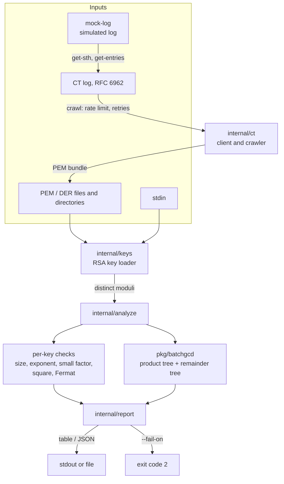

# rsa-ct-analyzer

Find weak RSA keys in X.509 certificates and Certificate Transparency logs: small moduli, bad exponents, factorable keys, reused keys, and primes shared between keys (batch GCD).

[](https://github.com/PaulPerigault/rsa-ct-analyzer/actions/workflows/ci.yml)
[](https://scorecard.dev/viewer/?uri=github.com/PaulPerigault/rsa-ct-analyzer)
[](go.mod)
[](LICENSE)

I maintain this alone. The rules of the repository are written once in [AGENTS.md](AGENTS.md) and checked in CI; decisions are in [docs/adr/](docs/adr/) and [docs/decisions-log.md](docs/decisions-log.md).

## Overview

Two RSA moduli that share one prime factor are both broken: `gcd(n1, n2)` returns the prime, and the private keys follow. This happens in the wild when a device generates keys with too little entropy at boot ([Heninger et al., *Mining your Ps and Qs*, USENIX Security 2012](https://factorable.net/)). Certificate Transparency logs publish most of the certificates issued on the web, so they are the natural corpus to look for it.

Comparing every pair of moduli is O(n²). This tool uses Bernstein's **batch GCD** (product tree, then remainder tree), which is quasi-linear, and adds the cheap checks that catch the other classic key-generation failures.

Design choices:

- **One static binary, pure Go.** No cgo, no external batch-GCD binary, no database ([ADR 0001](docs/adr/0001-single-go-binary.md), [ADR 0002](docs/adr/0002-native-batch-gcd.md)). `math/big` does the arithmetic, `crypto/x509` the parsing. One runtime dependency: `cobra`.
- **Works offline.** `scan` reads local PEM/DER files. For the CT side, `mock-log` serves a simulated RFC 6962 log from local certificates, and the tests replay entries recorded from a public log ([testdata/ct](testdata/ct/README.md)). The public network is never used in tests.
- **Composable.** `crawl` writes a PEM bundle on stdout, `scan -` reads stdin, JSON output and `--fail-on` exit codes plug into CI.
- **Safe by default.** Recovered primes are not printed unless `--reveal-factors` is set. `crawl` sends only rate-limited `GET`s, with bounded response sizes.

| Check | ID | Severity |
| --- | --- | --- |
| Modulus below 1024 bits / below `--min-bits` (default 2048) | `key-size` | critical / high |
| Public exponent invalid (e < 3 or even) / 3 / below 65537 | `public-exponent` | critical / medium / low |
| Divisible by a prime below 2¹⁶ | `small-factor` | critical |
| Perfect square (n = p²) | `perfect-square` | critical |
| Modulus is prime | `prime-modulus` | critical |
| Close primes, factored by Fermat's method | `close-primes` | critical |
| Prime shared with another key (batch GCD) | `shared-prime` | critical |
| Same key in several inputs | `duplicate-key` | high |
| Certificate signed with MD2/MD4/MD5/SHA-1 | `weak-signature` | medium |
| Certificate expired | `expired` | low |
| Private key given as input | `private-key-material` | medium |

## Context

- **Period:** 2025-10 to 2025-12 (first commit 2025-10-26, last commit of the original project 2025-12-18, 18 commits). Rewritten and industrialized on 2026-11-12.
- **Origin:** coursework at ESIEA (applied cryptography module, school year 2025-2026), done in a team of two. The school report is not published.
- **Why:** the assignment was to audit Certificate Transparency logs for RSA weaknesses, namely reused keys and shared prime factors, with a crawl target above one million certificates. The original design chained three binaries through a SQLite database and an external C++ batch GCD tool.
- **What was redone, and when:** on 2026-11-12 the project became one pure-Go binary (no cgo, no external tool, no database), with sample data generated from a fixed seed, fixtures recorded once from a public log, tests that run offline, pinned tooling and CI ([decisions log](docs/decisions-log.md)). The legacy repository is kept private.

## Architecture



`scan` loads keys, merges identical moduli (a duplicate is reported once as `duplicate-key` and would otherwise make batch GCD return `n` itself), runs the per-modulus checks on a worker pool, runs batch GCD on the distinct moduli, then renders the report. `crawl` is independent: it only produces certificates. The package direction (`cmd` → `cli` → `analyze`/`ct`/`keys` → `pkg/batchgcd`) is enforced by `depguard`.

## Quick Start

Prerequisites: Go 1.26+ and [Task](https://taskfile.dev) (`go install github.com/go-task/task/v3/cmd/task@latest`, or run the pinned copy with `go tool -modfile=tools/go.mod task`). Docker is optional.

```bash
git clone https://github.com/PaulPerigault/rsa-ct-analyzer.git
cd rsa-ct-analyzer
cp .env.example .env
task setup     # modules, pinned tools, Git hooks
task demo      # offline pipeline: simulated CT log -> crawl -> scan
```

Or step by step:

```bash
task build                                                   # bin/rsa-ct-analyzer
./bin/rsa-ct-analyzer scan testdata/certs                    # table output
./bin/rsa-ct-analyzer scan -f json --fail-on high testdata/certs > report.json; echo $?   # 2
```

With Docker, nothing else to install:

```bash
docker compose up --build --abort-on-container-exit --exit-code-from scan
```

### Usage

```text
rsa-ct-analyzer scan [path|-]...    audit local certificates and keys
rsa-ct-analyzer crawl               download RSA certificates from a CT log
rsa-ct-analyzer mock-log path...    serve local certificates as a simulated CT log
rsa-ct-analyzer --version
```

`scan` reads X.509 certificates, PKIX and PKCS#1 public keys, and private keys, in PEM or DER. Directories are walked recursively. In a PEM bundle each entry is named `file#N`. The block below is the real output, regenerated by `task docs:readme` and checked in CI:

<!-- BEGIN scan-output (generated by `task docs:readme`, do not edit) -->
```console
$ rsa-ct-analyzer scan testdata/certs --min-severity medium
SEVERITY  FINDING          KEY           BITS  SOURCE                                                                         DETAIL
critical  close-primes     4dbbb07d753f  2048  testdata/certs/close-primes.pem                                                the two primes are close: factored with Fermat's method
critical  shared-prime     f8786b389096  2048  testdata/certs/shared-prime-a.pem                                              shares a 1024-bit prime with 1 other key(s)
critical  shared-prime     af70837e6cf0  2048  testdata/certs/shared-prime-b.pem                                              shares a 1024-bit prime with 1 other key(s)
critical  small-factor     2ac08cc70172  2048  testdata/certs/small-factor.pem                                                modulus is divisible by the small prime 101
critical  key-size         b9f1df396817  512   testdata/certs/weak-512.pem                                                    512-bit RSA modulus can be factored with commodity hardware
high      duplicate-key    7e1347517ced  2048  testdata/certs/duplicate-of-ok-2048.pem, testdata/certs/ok-2048.der (+1 more)  the same RSA key is used by 3 inputs
high      key-size         400d7566ab7c  1024  testdata/certs/weak-1024.pem                                                   1024-bit RSA modulus is below the 2048-bit minimum
medium    public-exponent  b5cd1eb4b471  2048  testdata/certs/weak-exponent-3.pem                                             public exponent 3 is fragile
medium    weak-signature   f8282a148fd1  2048  testdata/certs/weak-sha1-signature.pem                                         certificate signed with SHA1-RSA

13 key(s) analyzed (11 distinct, 1 non-RSA skipped): 5 critical, 2 high, 2 medium, 1 low
```
<!-- END scan-output -->

Useful flags (`--help` lists all): `-f table|json`, `-o file`, `--min-severity`, `--min-bits 2048`, `--fermat-rounds 10000` (0 disables), `--no-batch-gcd`, `--reveal-factors`, `--workers`.

Exit status: `0` clean, `1` error, `2` a finding reached `--fail-on` (`low`, `medium`, `high`, `critical`; default `none`).

Crawl a log, then scan what came back:

```bash
export RSA_CT_LOG_URL=https://ct.googleapis.com/logs/us1/argon2026h2    # or the local mock-log
./bin/rsa-ct-analyzer crawl --count 5000 --rate-limit 2 | ./bin/rsa-ct-analyzer scan --fail-on critical -
```

`crawl` reads the latest `--count` entries (or from `--start`), keeps RSA certificates, counts the rest, and handles precertificates, short pages, `429` and `5xx` (retries with backoff, honours `Retry-After`). Every length field of a log entry is checked and its size bounded. Keep the rate low on public logs.

Configuration comes from flags, then from `RSA_CT_LOG_URL`, `RSA_CT_RATE_LIMIT`, `RSA_CT_TIMEOUT` and `RSA_CT_MOCK_ADDR` (see [`.env.example`](.env.example)).

### As a library

`pkg/batchgcd` is public and has no dependency:

```go
gcds, err := batchgcd.Compute(ctx, moduli) // gcds[i] = gcd(moduli[i], product of the others)
```

## Development

```bash
task setup        # modules, .env, Git hooks (Lefthook)
task verify       # fmt, lint, tests -race, docs, testdata, govulncheck, gitleaks
task test         # go test -race -count=1 -cover ./...
task lint         # go vet + golangci-lint (depguard, funlen, gocyclo)
task security     # govulncheck and gitleaks (tree and history)
task build:all    # five platforms in dist/ with SHA256SUMS
task data:gen     # regenerate testdata/ (deterministic; task data:check compares)
task docs:readme  # regenerate the sample output above
task docker:build # distroless, non-root image
task docker:scan  # Trivy on the image
```

Dev tools (`golangci-lint`, `govulncheck`, `gitleaks`, `lefthook`, `task`) are Go `tool` directives in [`tools/go.mod`](tools/go.mod): versions and hashes are locked by `tools/go.sum`, nothing is downloaded unverified ([ADR 0003](docs/adr/0003-taskfile-and-lefthook.md)). Hooks: `pre-commit` (gitleaks on staged files, gofmt, lint), `commit-msg` (Conventional Commits), `pre-push` (`task verify`).

CI ([`.github/workflows/ci.yml`](.github/workflows/ci.yml)): lint, tests with `-race` on Linux/macOS/Windows, docs and data checks, cross-platform build, offline end-to-end run, `govulncheck` and `gitleaks` on the full history, CodeQL, zizmor, image build with a non-root check and Trivy, and one aggregate `ci` job as the only required check. Actions are pinned by SHA. Releases are cut by release-please and built by [`release.yml`](.github/workflows/release.yml) with checksums and a provenance attestation, never from a workstation.

Contributing: [CONTRIBUTING.md](CONTRIBUTING.md), [CODE_OF_CONDUCT.md](CODE_OF_CONDUCT.md). Vulnerabilities: [SECURITY.md](SECURITY.md).

## Project Structure

```text
cmd/rsa-ct-analyzer/    main: signal handling, exit codes
internal/
  cli/                  cobra commands: scan, crawl, mock-log
  keys/                 load RSA keys from PEM/DER, files, directories, stdin
  analyze/              checks, findings, report model, worker pool
  report/               table (text/tabwriter) and JSON rendering
  ct/                   RFC 6962 client (rate limit, retries) and crawler
  ct/mocklog/           simulated CT log for tests and demos
  version/              build information (ldflags)
pkg/batchgcd/           reusable batch GCD on math/big
dev/                    gen-testdata, readme-gen, checkdocs, commitlint
tools/                  go.mod with the pinned dev tools (tool directives)
testdata/               generated certificates and keys; ct/ holds recorded RFC 6962 responses
docs/                   adr/, decisions-log.md, journal/
.github/                workflows, labels.json, milestones.json, issue forms, backlog/
Taskfile.yml            every task; lefthook.yml: Git hooks
Dockerfile              multi-stage, distroless, non-root
```

## Related

- [paulperigault.fr](https://paulperigault.fr): the author's portfolio. A project page links here, and the playground of the next milestone will be deployed with the same method as the portfolio (Cloudflare Pages, OpenTofu).
- [PaulPerigault/design-system](https://github.com/PaulPerigault/design-system): the `@paulperigault/*` packages. The web playground consumes its tokens and CSS; its Rust/WebAssembly packages are the model for the planned `crates/rsa-core`.

## Roadmap

Planned work is tracked in milestones, with the issues written in [`.github/backlog/`](.github/backlog/):

- **v0.1.0 Initial public release**: this repository as it is.
- **v0.2.0 Web playground (Rust/WASM + Astro)**: in-browser analysis, conformance tests between the Go and Rust implementations on golden files ([ADR 0004](docs/adr/0004-rust-wasm-playground.md), proposed).
- **v0.3.0 Real CT logs & hardening**: resumable crawl of a real log, versioned JSON Schema, benchmarks.

## Limits

- Batch GCD finds primes shared **between the keys you give it**. It cannot prove a key is safe, only that it is not trivially broken.
- Fermat's method is bounded (`--fermat-rounds`): it catches close primes, not every structured weakness. ROCA and other fingerprint-based checks are not implemented.
- `crawl` does not verify signed tree heads or SCTs: it audits keys, not the log. It has no checkpoint yet: an interrupted crawl restarts (v0.3.0).
- `math/big` is slower than GMP and memory grows with the number of moduli (the product tree holds roughly the size of all moduli). No benchmark is published yet; do not assume millions of keys fit on a laptop.
- The CT fixtures are four entries of one log, recorded on 2026-11-12: they cover the parser, not the variety of real logs.

## Author

Paul Perigault — Cloud & DevOps Engineer | [paulperigault.fr](https://paulperigault.fr)

Released under the [MIT license](LICENSE).
